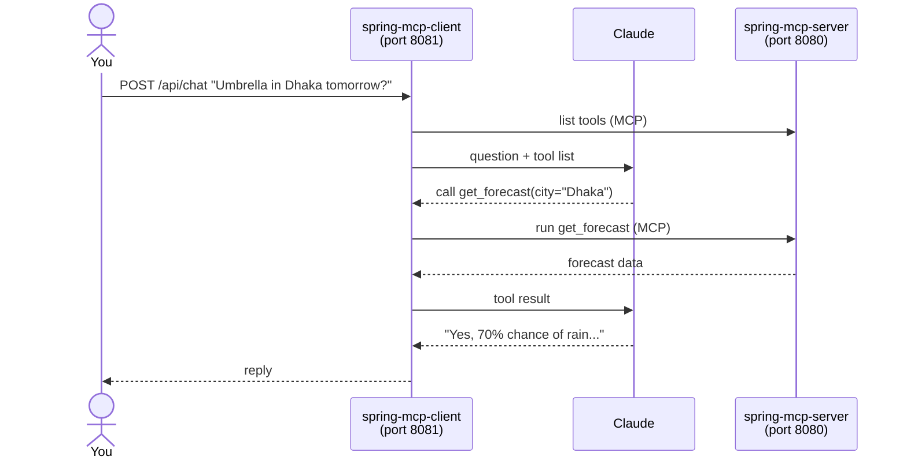

# Spring MCP Client

A **Spring Boot + Spring AI** app that connects **Claude** to an [MCP](https://modelcontextprotocol.io) server.
Ask a question in plain English; Claude decides which of the server's tools to call, and Spring AI runs them for it.

It's the client for **[spring-mcp-server](https://github.com/msiShariful/spring-mcp-server)**, which provides weather and personal task tools.

[](https://github.com/msiShariful/spring-mcp-client/actions/workflows/ci.yml)
[](LICENSE)


---

## Table of contents

- [How it works](#how-it-works)
- [Features](#features)
- [Prerequisites](#prerequisites)
- [Getting started](#getting-started)
- [API](#api)
- [Configuration](#configuration)
- [Project structure](#project-structure)
- [Testing](#testing)
- [Troubleshooting](#troubleshooting)
- [License](#license)

---

## How it works



The client never decides which tool to use. **Claude** does, based on the tool names and descriptions the server provides.

## Features

| Feature | Endpoint | What it does |
|---|---|---|
| **Chat** | `POST /api/chat` | Talk to Claude; it calls the server's tools as needed |
| **Conversation memory** | `conversationId` field | Follow-up questions keep context (last 20 messages) |
| **Run server prompts** | `POST /api/prompts/{name}` | Run ready-made workflows like `plan_my_day` through Claude |
| **Explore the server** | `GET /api/mcp/*` | See the server's info, tools, resources and prompts (no AI) |
| **Server authentication** | `MCP_SERVER_API_KEY` | Sends the API key the server's task tools need |
| **Clear errors** | all endpoints | Short JSON messages, e.g. a missing Claude key returns 503 |

## Prerequisites

| Tool | Version | Needed for |
|---|---|---|
| JDK | 25+ | Building and running |
| [spring-mcp-server](https://github.com/msiShariful/spring-mcp-server) | latest | The tools Claude uses |
| Anthropic API key | — | Talking to Claude ([get one](https://console.anthropic.com/)) |

## Getting started

### 1. Start the MCP server

```bash
git clone git@github.com:msiShariful/spring-mcp-server.git
cd spring-mcp-server
./mvnw spring-boot:run          # runs on http://localhost:8080
```

### 2. Set your keys

```bash
export ANTHROPIC_API_KEY="sk-ant-..."      # required: your Claude key
export MCP_SERVER_API_KEY="mcp_..."        # optional: enables the server's task tools
```

Without `MCP_SERVER_API_KEY`, only the server's public weather tools work.

> In IntelliJ, add these under **Run → Edit Configurations → Environment variables**.
> Never commit keys to the repository.

### 3. Start the client

```bash
git clone git@github.com:msiShariful/spring-mcp-client.git
cd spring-mcp-client
./mvnw spring-boot:run          # runs on http://localhost:8081
```

### 4. Ask something

```bash
curl -X POST http://localhost:8081/api/chat \
  -H "Content-Type: application/json" \
  -d '{"message": "Do I need an umbrella in Dhaka tomorrow?"}'
```

```json
{
  "conversationId": "3f2b9c1e-...",
  "reply": "Yes, take an umbrella. Tomorrow in Dhaka there's a 70% chance of rain..."
}
```

More examples are in [`requests.http`](requests.http). Open it in IntelliJ and click ▶ next to any request.

## API

### Chat

```http
POST /api/chat
{"message": "Add a task to renew my passport by Friday"}
```

To continue a conversation, send the `conversationId` from the previous reply:

```http
POST /api/chat
{"conversationId": "3f2b9c1e-...", "message": "Make it high priority"}
```

### Run a server prompt

```http
POST /api/prompts/plan_my_day
{"arguments": {"city": "Dhaka"}}
```

Returns the `prompt` the server generated, Claude's `reply`, and a `conversationId` you can continue in `/api/chat`.

| Prompt | Arguments |
|---|---|
| `plan_my_day` | `city` (required) |
| `weekly_review` | none |
| `trip_prep` | `city` (required), `days` (optional) |

### Explore the server (no AI)

| Endpoint | Returns |
|---|---|
| `GET /api/mcp/server` | Server name, version, instructions |
| `GET /api/mcp/tools` | Tools with `readOnly` / `destructive` hints |
| `GET /api/mcp/resources` | Resources and resource templates |
| `GET /api/mcp/resources/read?uri=weather://Dhaka` | One resource's content |
| `GET /api/mcp/prompts` | Prompts and their arguments |

### Errors

Errors are returned as JSON: `{"status": 503, "error": "Claude API key is missing or invalid. Set ANTHROPIC_API_KEY."}`

| Status | When |
|---|---|
| 400 | Bad input, e.g. empty message or invalid JSON |
| 429 | Claude rate limit reached |
| 502 | The MCP server or Claude returned an error |
| 503 | Claude key missing/invalid, or no MCP server connected |

## Configuration

All settings are in [`application.yaml`](src/main/resources/application.yaml) and can be overridden with environment variables:

| Environment variable | Default | Purpose |
|---|---|---|
| `ANTHROPIC_API_KEY` | — | Claude API key (**required**) |
| `ANTHROPIC_MODEL` | `claude-sonnet-5-5` | Claude model to use |
| `MCP_SERVER_URL` | `http://localhost:8080` | MCP server address (endpoint `/mcp`) |
| `MCP_SERVER_API_KEY` | — | API key for the server's task tools |

The client runs on port **8081** because the server uses 8080.

## Project structure

```
src/main/java/com/islamshariful/spring_mcp_client/
├── SpringMcpClientApplication.java
├── config/
│   └── McpServerAuthConfig.java     # Adds the server API key to every MCP request
├── chat/
│   ├── ChatService.java             # Claude + MCP tools + conversation memory
│   └── ChatController.java          # POST /api/chat
├── prompts/
│   └── PromptController.java        # POST /api/prompts/{name}
├── mcp/
│   ├── McpExplorerService.java      # Calls the MCP server directly (tools, resources, prompts)
│   └── McpExplorerController.java   # GET /api/mcp/*
└── web/
    └── ApiExceptionHandler.java     # Turns errors into clear JSON
```

## Testing

```bash
./mvnw verify
```

The tests don't need the MCP server or a Claude key. They use a fake chat model and mocked services, so they also run in CI.

## Troubleshooting

| Problem | Fix |
|---|---|
| App fails to start: connection refused | Start **spring-mcp-server** first, or check `MCP_SERVER_URL`. |
| `503 Claude API key is missing or invalid` | Set `ANTHROPIC_API_KEY` and restart. |
| Claude says it needs authentication for tasks | Set `MCP_SERVER_API_KEY` to a key from the server's `app.security.api-keys`. |
| `Port 8081 was already in use` | Stop the other process or run with `--server.port=8082`. |
| New server tools don't show up | Restart the client so it reconnects to the server. |

## License

Released under the [MIT License](LICENSE).
